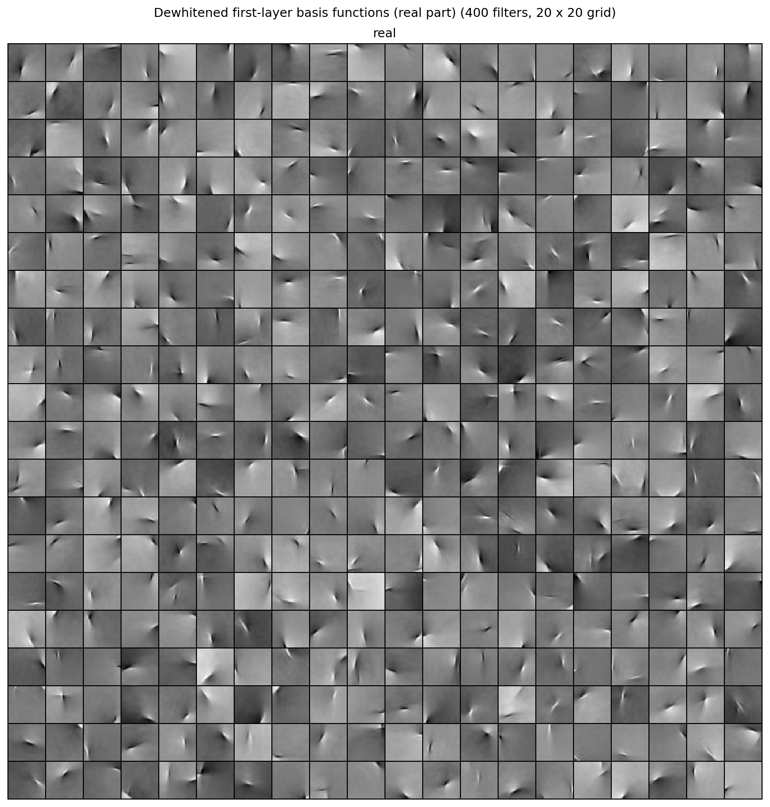
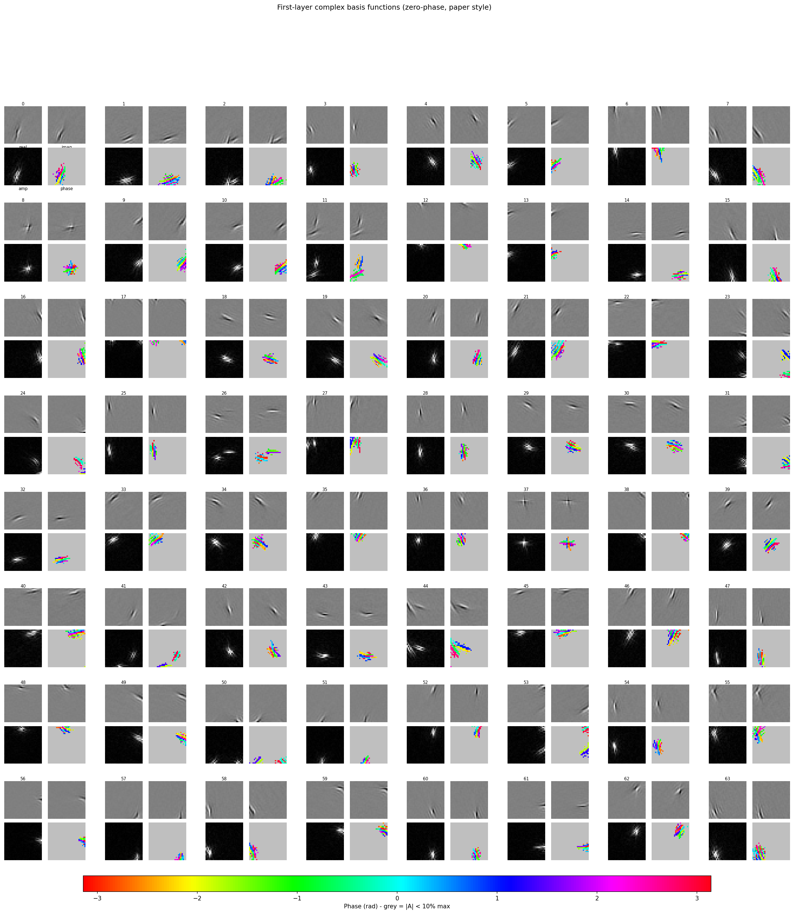

# twolayer-torch

A PyTorch implementation of the two-layer model for learning intermediate-level
representations of form and motion from natural movies.

Layer 1 learns a complex-valued basis in whitened patch space. Layer 2 then
learns a real form (amplitude) basis ``B`` and a real motion (phase-transition)
basis ``D`` from the layer-1 MAP estimates. Training scripts are provided for
each layer, plus analysis utilities.





## Paper

Learning Intermediate-Level Representations of Form and Motion from Natural Movies
Charles F. Cadieu and Bruno A. Olshausen
Neural Computation 2012 24:4, 827-866

The hyperparameters and algorithms are borrowed from the original MATLAB implementation:
https://github.com/cadieu/twolayer

## Datasets

The code trains on two datasets:

* **BSD500** — the Berkeley Segmentation Dataset (500 natural still images).
* **Natural Movies** by Hans van Hateren — raw movie chunks:
  http://redwood.berkeley.edu/cadieu/data/vid075-chunks.tar.gz

Both are loaded from local directories (gitignored); see ``config.py`` and the
training scripts for the expected layout.

## Training

Run from the ``twolayer-torch`` directory:

```
python train_layer1.py          # layer-1 complex basis
python train_layer2_form.py     # layer-2 form (amplitude) basis B
python train_layer2_motion.py   # layer-2 motion (phase-transition) basis D
```

See ``python train_layer*.py --help`` for options.
